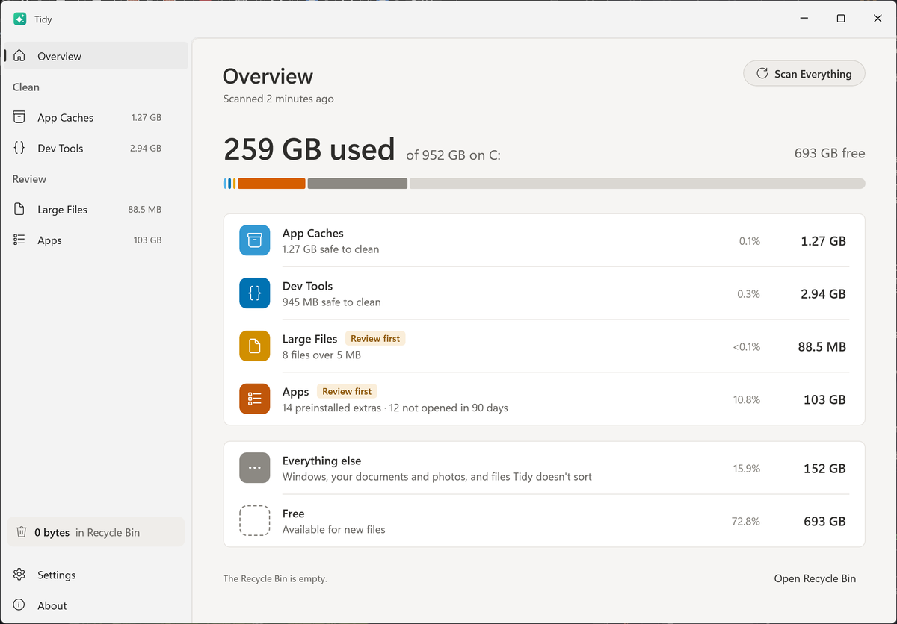
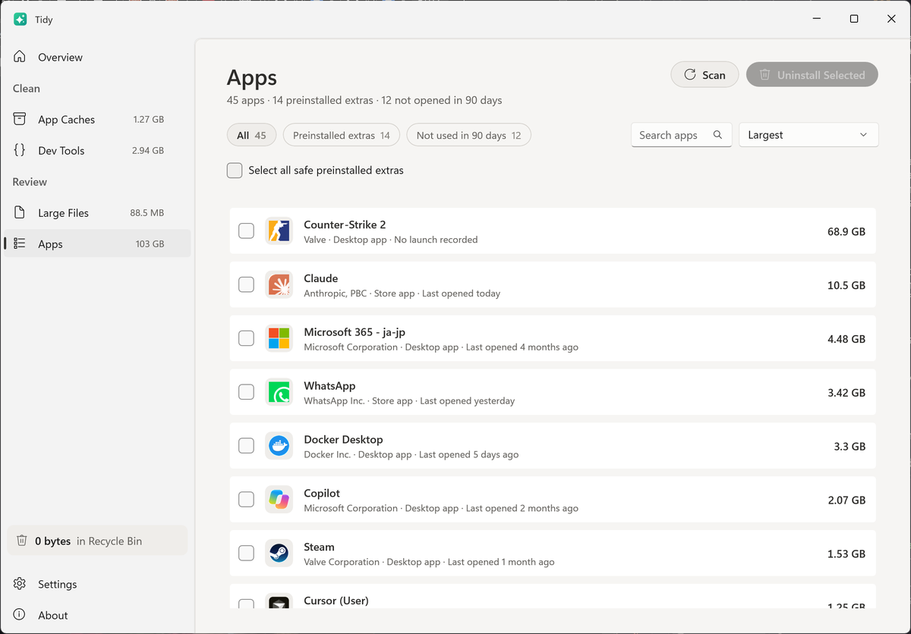

<div align="center">


# Tidy

**Free up your PC. Safely.**

A free, open-source Windows app that clears the cache and junk your PC piles up on its own.
Files go to the Recycle Bin first, so you can put them back.

[Website](https://baala3.github.io/tidy) · [Download](https://github.com/baala3/tidy/releases/latest) · [Safety](https://baala3.github.io/tidy/safety.html)

<picture>
  <source media="(prefers-color-scheme: dark)" srcset="docs/screenshots/overview-dark.png">
  
</picture>

</div>

## Install

In PowerShell:

```powershell
irm https://baala3.github.io/tidy/install.ps1 | iex
```

The script downloads the latest release, checks it against the published SHA-256, and installs Tidy for your account in `%LOCALAPPDATA%\Programs\Tidy`.
It needs no admin rights, adds a Start menu shortcut, and adds Tidy to Settings > Apps so you can uninstall it there.

Or download the zip for your PC from [Releases](https://github.com/baala3/tidy/releases/latest), extract it anywhere, and run `Tidy.exe`.
Tidy is not code-signed yet, so Windows SmartScreen may say "Windows protected your PC".
Choose **More info**, then **Run anyway**.

Tidy runs on Windows 10 (version 2004) and Windows 11, on x64 and Arm64.

## What it clears

### App Caches

- Temp files untouched for a day, crash dumps, Windows error reports and DirectX, NVIDIA, AMD and Intel shader caches.
- Browser caches for every Chrome, Edge, Brave, Vivaldi, Opera and Firefox profile.
  Passwords, history, cookies and sign-ins sit next to these and are never touched.
  A browser that is open is skipped until you close it.
- Caches of Electron apps like Discord, Slack, Notion and Teams, recognized by the cache's own file layout.

### Dev Tools

- Package caches for npm, pnpm, Yarn, Bun, Deno, NuGet, Gradle, Maven, Cargo, Go, pip, uv, Poetry, conda, Composer, vcpkg and Scoop.
- Editor caches for VS Code, Cursor, JetBrains IDEs and Visual Studio.
- Rebuildable folders in old projects: `node_modules`, Rust `target`, .NET `bin` and `obj`, Python environments, Gradle and Maven output, and more.
  A project shows up only when nothing in it changed for the stale period you choose (6 months by default), and never while a terminal, dev server or git command is working inside it.

### Apps

- **Preinstalled extras:** games, promos and trials that came with Windows or your PC, each marked Safe to Remove or Check First with a note on what it does.
- **Not used in 90 days:** from the launch history Windows keeps for Start, the taskbar and File Explorer.
- Runtimes, codecs, drivers, the Store, Windows Security and Xbox sign-in parts are never offered.
- Store apps are removed for your account and can be reinstalled from the Microsoft Store.
  Desktop apps run their own uninstaller, the same one Settings > Apps opens.

### Large Files

- Big files in Documents, Desktop, Downloads, Videos, Music and Pictures, with search, size and age filters, and type chips.
- Nothing is selected for you, and files that live only in OneDrive are left alone.

<picture>
  <source media="(prefers-color-scheme: dark)" srcset="docs/screenshots/apps-dark.png">
  
</picture>

## Safety

Tidy deletes files, so it is built to be sure rather than thorough.

- Caches are offered only from a fixed allowlist, and anything Tidy does not recognize never shows up.
- Every path is checked again at the moment it is removed, not just when it was scanned.
- Anything behind a link or junction is refused, and so are credential stores and password managers.
- Files go to the Recycle Bin. If the Recycle Bin is off for a drive, or an item is too big for it, Tidy leaves the item alone rather than delete it for good.
- Tidy makes no network requests and collects no data.

The [safety page](https://baala3.github.io/tidy/safety.html) lists everything Tidy may clear and everything it refuses.
It is generated from the app's own rules.
Incidents are logged in [docs/safety-notes.md](docs/safety-notes.md), and [SECURITY.md](SECURITY.md) says how to report one.

## Build from source

You need Windows and the [.NET 10 SDK](https://dotnet.microsoft.com/download).

```powershell
git clone https://github.com/baala3/tidy
cd tidy
.\build.ps1 -Target test
.\build.ps1 -Target run
```

[CONTRIBUTING.md](CONTRIBUTING.md) explains how the code is laid out and the rules for changes.

## Credits

Tidy is based on [Purge for Mac](https://github.com/jithin-sabu/purge-app) by Jithin Sabu, used under the MIT License.
Its deletion-safety approach, safety tiers and many explanations come from Purge.
Tidy is an independent project and is not affiliated with Purge.
See [THIRD-PARTY-NOTICES.md](THIRD-PARTY-NOTICES.md).

## License

[MIT](LICENSE)
